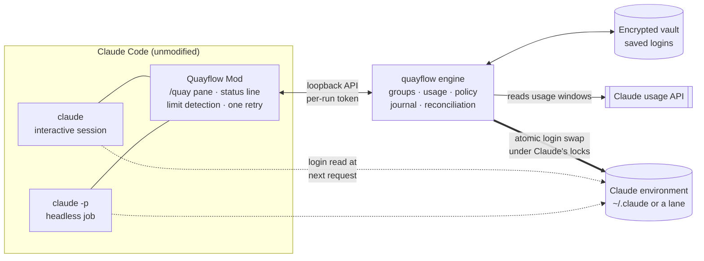
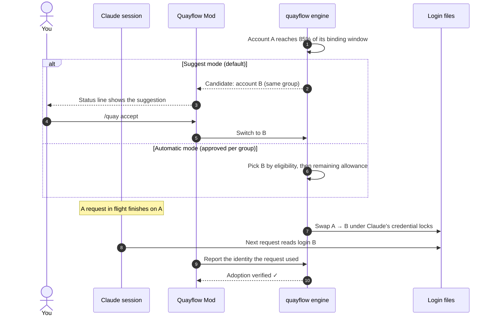
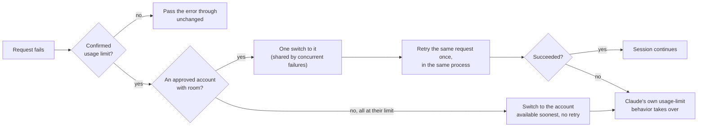

<div align="center">

<picture>
  <source media="(prefers-color-scheme: dark)" srcset="assets/brand/quayflow-logo-dark.png">
  
</picture>

**Change your port. Keep your flow.**

Switch between your approved Claude accounts without leaving your Claude Code session,<br/>
whether you are at the keyboard or a `claude -p` job is running on its own.

[](https://github.com/minhdaohuu/quayflow/actions/workflows/ci.yml)
[](https://github.com/minhdaohuu/quayflow/releases)
[](LICENSE)


[See it in action](#see-it-in-action) · [Headless jobs](#headless-jobs-too) · [Features](#features) · [How it works](#how-it-works) · [Install](#install) · [Quick start](#quick-start) · [Documentation](#documentation) · [Roadmap](#roadmap)

</div>

> [!IMPORTANT]
> **You are responsible for complying with your provider's terms and your organization's rules**, including rules about which accounts may process your organization's work. Use only accounts that are yours to use. Quayflow does not make sharing accounts, or getting around a provider's limits, allowed where its terms forbid it. Quayflow is an independent open-source project and is **not affiliated with or endorsed by Anthropic**.

**Status:** v0.1.4, public pilot. Quayflow targets every platform Claude Code runs on; **Windows is the first release (MVP)**, with macOS and Linux to follow. Switching, recovery from a real usage limit and headless `claude -p` jobs have been tested end to end with real accounts; see [acceptance results](docs/acceptance.md) for what is proven and what is still open.

## What and why

If you use more than one Claude subscription, for example a work seat and a personal plan, each has its own usage windows. When one runs low, the usual fix is to sign out, sign in again, and restart your session, which breaks your flow.

Quayflow does that switch for you, in place. The running session continues on the next account at its next request, with the same conversation and process, and nothing is replayed. It also makes the switch safe to automate:

- **You decide which accounts may serve which projects.** Groups are explicit data approvals; mixing organization and personal accounts needs a one-time disclosure.
- **It switches only when it should.** It acts on fresh usage readings; stale data never counts as zero. Suggest mode is the default; Automatic is opt-in per group.
- **It never touches your work.** No killed tools, no lost input, no replayed actions, and at most one retry of a request that hit a confirmed usage limit.
- **Your normal commands stay.** You keep typing `claude` and `claude -p`. There is no wrapper or launcher, and no change to how commands resolve.
- **Headless jobs keep going.** A `claude -p` job that hits a usage limit is moved to an account with room and its request is retried once, inside the same run. Its output and exit code stay Claude's own.

## See it in action

The outputs below are real, from a machine with three accounts in one group: `work` (organization), `personal`, and `sdk`, whose weekly limit is used up.

### 1. Quayflow watches every account

`quayflow status` (or `/quay` inside Claude) shows each account's fullest usage window, how old the reading is, and whether it could take over:

```text
Environment default - live: personal - mode automatic - groups Default
  decision: personal at 28% 5h (0 s old), below 85%
  sessions on this login (1; other clients such as editor extensions may not be listed):
    quayflow-4b - busy - group Default - Claude 2.1.319

Accounts:
  work             organization 49% 7d (2 min old)           49% 7d (2 min old)
> personal         personal     28% 5h (0 s old)             already live
  sdk              organization 100% 7d (7 min old)          at its limit (100% 7d)
```

Idle accounts stay readable: when an idle account's access token expires, the engine refreshes that account's saved copy, so its usage is current and it can be chosen. A reading that is out of date is shown as unknown, never as a figure.

### 2. Near the limit, it suggests (or switches)

In Claude Code the status line says what Quayflow would do, for example:

```text
Quayflow · work · Suggest · 5h 91% · 7d 40% | personal suggested
```

`/quay accept` (or **Switch** in the pane) moves the login. Every session of that Claude environment continues on the new account at its next request: same conversation, same process. In Automatic mode the engine makes the switch by itself.

### 3. A request hits a real usage limit

Here the live account was switched to `sdk` (weekly limit used up) and a prompt was sent. The engine log shows the whole recovery, in Automatic mode:

```text
19:53:44 failure.shape      seven_day 100%, simulated: false     ← Claude reports the limit
19:53:44 transition.written sdk -> personal, how: recovery, lockedMs: 17
19:53:44 recovery.decision  retry: true, switched: true          ← one switch, one retry
19:53:51 adoption           used: personal, ok: true             ← the retried request ran on personal
```

The person saw a normal answer. In Suggest mode Quayflow does not switch by itself: the transcript says `Usage limit reached. Suggest switching to personal: /quay accept`, and accepting moves the session on.

### 4. Headless jobs: same output, fewer failures

A `claude -p` job that starts on `sdk`:

```powershell
claude -p "Reply with exactly: HEADLESS-OK" --output-format json
```

returns Claude's normal JSON with exit code 0. Quayflow switched to `personal` and retried the request once inside the run, about 3 seconds longer than a run that never hit a limit. Nothing from Quayflow appears in stdout or stderr. Three jobs that hit the limit at the same moment share one switch.

When there is nothing to switch to (every approved account at its limit, or the group in Suggest mode), the job gets Claude's own result, unchanged:

```text
is_error: true    exit code: 1
result:   "You've hit your weekly limit · resets 11am (Asia/Ho_Chi_Minh)"
```

A script or agent can ask what happened, and when it is worth running again, with the `session_id` from Claude's output:

```text
> quayflow last --session a04910ad-30f6-4c2a-8bd8-94a317333a02
Session a04910ad-30f6-4c2a-8bd8-94a317333a02: not recovered
  limit:        sdk at 100% 7d (resets 2026-11-08T04:00:00.000Z)
  run again at: 2026-11-08T04:00:00.000Z
  why:          Suggest mode: no automatic switch; /quay accept switches to personal
```

```json
{
  "session": "0c0920b0-589a-4d53-996d-532ef2d19efd",
  "outcome": "recovered",
  "limit": { "account": "sdk", "window": "7d", "pct": 100.0, "resetsAt": "2026-11-08T04:00:00.000Z" },
  "switchedTo": "personal",
  "retried": true,
  "availableAt": null,
  "why": "sdk hit a usage limit (100% seven_day as seen by the session); personal at 24% 5h (4 s old)"
}
```

A new `claude -p` started after the wait reads the login when it starts, so it runs on whichever account Quayflow left live. See [Headless jobs](docs/user-guide.md#headless-jobs-claude--p).

## A look at `/quay`

Type `/quay` in Claude Code to open the Quayflow pane. The Overview shows the live account's 5-hour and 7-day windows with countdowns to each reset, then every account side by side as a chart: each column warms from green to red as it fills, the dashed line is the switch threshold, ▼ marks the live account and ★ the suggested one.

<p align="center">
  
</p>

Accepting a suggestion opens a short review before anything changes: which sessions move, the target's usage, the checks that passed and an optional wait for an idle moment.

<p align="center">
  
</p>

<sub>Rendered from the Mod's own drawing code with sample data. In the terminal the pane draws in true color; the desktop app and IDE panels show the same figures as text gauges.</sub>

## Headless jobs too

Everything above works the same when nobody is watching. Scheduled tasks, scripts and agent pipelines that run `claude -p` get the same switching and recovery, tuned for unattended work:

| | Without Quayflow | With Quayflow (group in Automatic) |
|---|---|---|
| A job hits a usage limit | The run ends with `is_error`, exit code 1 | The same run switches to an account with room, retries that request once and answers normally |
| Several jobs hit it at once | Every run fails | One shared switch; each run retries once and answers |
| Every account is at its limit | The run ends with Claude's limit message | The same message and exit code, untouched; Quayflow moves to the account available soonest so the next run starts there |
| Your script needs to know why | Parse Claude's text | `quayflow last --session <id> --json`: `recovered`, `all_exhausted` or `not_recovered` with the reason, the limit hit and `availableAt`, the earliest time worth running again |

What it promises a pipeline:

- **Byte-for-byte output.** Nothing from Quayflow ever reaches a headless run's stdout or stderr, and the exit code is Claude's. Parsers, retries and dashboards built for plain `claude -p` keep working.
- **No prompts, no hangs.** A headless run is never asked anything. Approvals are typed once, ahead of time (`quayflow mode automatic --group <G> --approve`).
- **Bounded behavior.** One switch and at most one retry per failed request; never a replay of completed work, never a second process.
- **Fresh runs pick up the switch.** A new `claude -p` reads the login when it starts, so an agent that waits and starts again lands on the account Quayflow left live.
- **Fails open.** With the engine stopped or not installed, `claude -p` behaves exactly as without Quayflow.

Proven with real accounts and a real weekly limit by [`tests/e2e/real-headless.ps1`](tests/e2e/real-headless.ps1): 42 of 42 checks, covering recovery, three parallel runs sharing one switch, Suggest mode, the engine stopped, and an agent's fail-wait-run-again loop. In those runs a recovered job took about 3 seconds longer than a run that never hit a limit. Setup and details: [Headless jobs](docs/user-guide.md#headless-jobs-claude--p).

## Features

| Feature | What it does |
|---|---|
| **In-place switching** | The running session moves to the next account at its next request: same conversation, same process, about 300 ms under Claude's own credential locks. |
| **Usage-aware** | Watches each account's five-hour, seven-day and per-model windows. Suggests (or, in Automatic mode, makes) a switch near the threshold, and returns to your Preferred account when it has room. |
| **Groups as approvals** | You decide which accounts may serve which projects. Organization-managed login rules are detected and respected. |
| **Hard-limit recovery** | On a confirmed usage limit: one switch and at most one retry of that request. Concurrent failures share one switch. When every account is at its limit, it moves to the one available soonest and leaves the rest to Claude. |
| **Verified, not assumed** | Every switch is checked against the account that each client's next request actually used. A mismatch turns in-place switching off for that Claude version. |
| **Lanes** | Keep one session on a different account in a separate environment that still links your shared Claude setup. |
| **Headless-ready** | `claude -p` output and exit code are unchanged and nothing prompts. `quayflow last` tells a script whether a run was recovered, why not, and when to run again. Without Quayflow running, Claude behaves exactly as before. |
| **Readable idle accounts** | An idle account's expired token is refreshed in its saved copy, so its usage stays current. The live login is Claude's to refresh. |
| **Local only** | Logins are sealed with the operating system's per-user protection. No telemetry; logs are scrubbed. |

## How it works



**A switch, step by step**



**When a request hits a usage limit**



In Suggest mode the switch is only suggested; in Manual mode nothing is switched. Either way Claude's own result stands.

1. You register your logins and put them in **groups**.
2. The engine watches each account's usage windows (five-hour, seven-day, per model): the live account every minute, idle accounts every ten minutes, and less often when the usage service asks it to slow down.
3. Near the threshold (85% by default) it **suggests** an account from the same group, or switches by itself in **Automatic** mode.
4. The switch replaces only the login entries of the Claude environment, under Claude's own locks, in about 300 ms. Requests in flight finish on the old account.
5. The Mod confirms which account each session's next request actually used.
6. Sessions that need a different account from the rest can run in a **lane**, a separate environment that links your shared Claude setup.

## Install

Windows 10/11 x64 with Claude Code installed. No administrator rights. In PowerShell:

```powershell
irm https://github.com/minhdaohuu/quayflow/releases/latest/download/install.ps1 | iex
```

The installer shows what it will do and asks for consent. It verifies `quayflow.exe` against the release's `SHA256SUMS`, and its GitHub build-provenance attestation from the release workflow, and refuses on a mismatch. Verifying the attestation needs the [GitHub CLI](https://cli.github.com/), signed in (`gh auth login`); without it the installer refuses unless you pass `-SkipAttestation`, which leaves the hash check alone. Releases from v0.1.5 on are attested; v0.1.0 to v0.1.4 were built while the repository was private and are not attested. It then installs to `%LOCALAPPDATA%\Quayflow\bin` and adds the Mod to Claude Code from the same release. Running it again upgrades.

<details>
<summary><b>Safer: download, verify, read, then run</b></summary>

```powershell
$v = 'v0.1.4'   # the release you want
$base = "https://github.com/minhdaohuu/quayflow/releases/download/$v"
Invoke-WebRequest -UseBasicParsing "$base/install.ps1" -OutFile install.ps1
Invoke-WebRequest -UseBasicParsing "$base/SHA256SUMS" -OutFile SHA256SUMS
(Get-FileHash install.ps1 -Algorithm SHA256).Hash.ToLower()   # compare with the install.ps1 line in SHA256SUMS
gh attestation verify install.ps1 --repo minhdaohuu/quayflow    # optional, needs the GitHub CLI
notepad install.ps1                                              # read it
powershell -ExecutionPolicy Bypass -File .\install.ps1 -Version $v
```

See [Verifying a release](docs/verify-release.md).
</details>

<details>
<summary><b>Installer options</b></summary>

| Option | Effect |
|---|---|
| `-Version v0.1.4` | A specific release instead of the latest |
| `-Startup` | Also start the engine at Windows sign-in |
| `-NoPath` | Do not add the install folder to your user PATH |
| `-NoPlugin` | Engine only; do not touch Claude Code plugins |
| `-Uninstall [-DeleteData]` | Remove Quayflow, optionally with its vault and logs |

With `irm | iex`, pass options like this: `& ([scriptblock]::Create((irm <url>))) -Startup`.

The installer adds the Mod for you, pinned to the engine's release. To add only the Mod by hand (it does nothing without `quayflow.exe`): `/plugin install quayflow --marketplace minhdaohuu/quayflow`.
</details>

## Quick start

1. Start Claude as usual: `claude`.
2. Run `/quay`, give the consents, and **register** the login you are using. It joins the `Default` group.
3. **Add** another account. A window opens with Claude's own sign-in; Quayflow never asks for a token.
4. Watch the status line: `Quayflow · <account> · Suggest · <status>`, for example `Quayflow · Work · Suggest · 5h 91% · 7d 40% | Personal suggested`. When it suggests a switch, run `/quay accept`.
5. Optional:
   - `quayflow mode automatic --group Default --approve` lets Quayflow switch by itself. Unattended `claude -p` jobs need this, because nobody is there to accept a suggestion.
   - After a headless run, `quayflow last --session <session_id>` says whether it was recovered and when to run again.
   - `quayflow shell install` lets a session be replaced in the same PowerShell terminal.

Everything is also available from the command line: `quayflow status`, `quayflow use <account>`, `quayflow group ...`. See the [user guide](docs/user-guide.md).

## Safety and disclaimer

- **Terms and organization rules are your responsibility.** Quayflow is not affiliated with or endorsed by Anthropic.
- **A switch moves every session of an environment** (by default `~/.claude`), each at its next request. Use lanes to keep a session on a different account.
- **Saved logins** are encrypted with Windows DPAPI for your user. This does not protect against malware running as you. Claude refreshes the live login and Quayflow saves the result; Quayflow refreshes only an idle account's saved copy so its usage stays readable. Logins never go into logs, reports or the Mod, and there is no telemetry.
- **Organization-managed login enforcement is respected.** The managed-login override setting is recorded but has no bypass path in this build. See [Security notes](docs/security.md#managed-login-enforcement-and-the-override-setting).
- **Releases are not Authenticode-signed.** They are reproducible, hashed (`SHA256SUMS`) and, from v0.1.5 on, carry build-provenance attestations. Smart App Control and signed-only company policies may block them. See [Verifying a release](docs/verify-release.md).
- **Idle accounts need a working saved login.** Quayflow refreshes an idle account's saved copy when its token expires. If the sign-in service refuses it, that account needs a new sign-in before it can be used again.
- **Prompt cache is per account.** The first request after a switch reprocesses the conversation.

Read [Known limits](docs/known-limits.md) before relying on Quayflow for unattended work.

## Documentation

| For users | |
|---|---|
| [User guide](docs/user-guide.md) | Install, onboarding, groups, modes, recovery, headless jobs, lanes, PowerShell integration, update, uninstall, troubleshooting |
| [Security notes](docs/security.md) | What Quayflow touches, the vault and its limits, logs, loopback API, managed-login setting |
| [Verifying a release](docs/verify-release.md) | Hashes, attestations, reproducible builds, SmartScreen and company policies |
| [Known limits](docs/known-limits.md) | Scope, undocumented dependencies, open release conditions, recovery procedures |

| For contributors | |
|---|---|
| [Requirements](docs/requirements.md) | Functional requirements (FR-xx) and release conditions |
| [Technical specification](docs/tech-spec.md) | Paths, schemas, API v1, CLI, Claude environment facts |
| [Acceptance results](docs/acceptance.md) | Scenario results against the product build |
| [Changelog](CHANGELOG.md) | Release history |

## Building from source

```powershell
cargo build --release --locked -p quayflow   # toolchain pinned by rust-toolchain.toml (1.98.0, MSVC)
cargo test --workspace --locked
pwsh -File tests/e2e/smoke-fake-env.ps1 -Exe target\release\quayflow.exe   # fake environment, no real logins
pwsh -File tests/e2e/cli-fake-env.ps1 -Exe target\release\quayflow.exe     # CLI behavior and error paths
pwsh -File tests/e2e/sim-usage.ps1 -Exe target\release\quayflow.exe        # scripted usage from a fake usage API
```

Owner-run scripts exercise real logins: `tests/e2e/real-switching.ps1`, `real-lanes.ps1` and `real-headless.ps1` (headless jobs against an account at its limit). They switch your live login; read [tests/e2e/README.md](tests/e2e/README.md) first.

Without Visual Studio Build Tools, set `$env:RUSTUP_TOOLCHAIN = '1.98.0-x86_64-pc-windows-gnu'` for local development. Releases are built by CI with MSVC.

<details>
<summary><b>Repository layout</b></summary>

| Path | Content |
|---|---|
| `crates/` | Rust workspace: engine, vault, adapter, policy, provider, CLI |
| `mod/quayflow/` | The Mod (TypeScript Claude Code plugin) |
| `shell/` | PowerShell integration (`Quayflow.psm1`) |
| `installer/` | `install.ps1` |
| `tests/e2e/` | Fake-environment smoke, CLI and simulation tests; owner-run real-login scenarios |
| `.github/workflows/` | CI and the reproducible release workflow |

</details>

## Roadmap

- **v0.1 (now, MVP):** Windows 10/11 x64 public pilot. Switching, real usage-limit recovery and headless jobs are proven with real accounts; the remaining [acceptance scenarios](docs/acceptance.md) close the pilot.
- **Next:** lanes for unattended jobs, with their own mode, so background jobs can switch without moving your interactive sessions.
- **Later:** macOS and Linux, each with the platform's own credential protection (Keychain, Secret Service) and shell integration; Authenticode signing.

Have a use case that is not covered? [Open an issue](https://github.com/minhdaohuu/quayflow/issues/new/choose).

## Contributing

Contributions are welcome. Please read [CONTRIBUTING.md](CONTRIBUTING.md) and the [Code of Conduct](CODE_OF_CONDUCT.md) first. Quayflow handles login files, so changes are held to a high bar for safety and honest evidence. Report security problems privately as described in [SECURITY.md](SECURITY.md), not in public issues.

## License

[MIT](LICENSE).

"Claude" and "Claude Code" are trademarks of Anthropic, PBC, used here only to describe compatibility.
