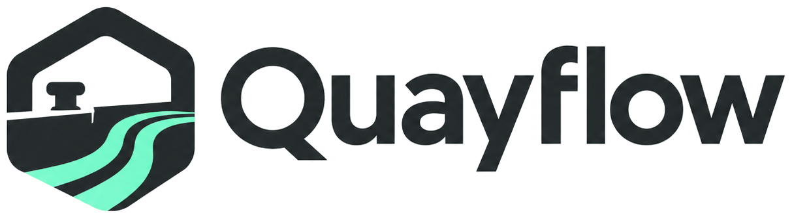
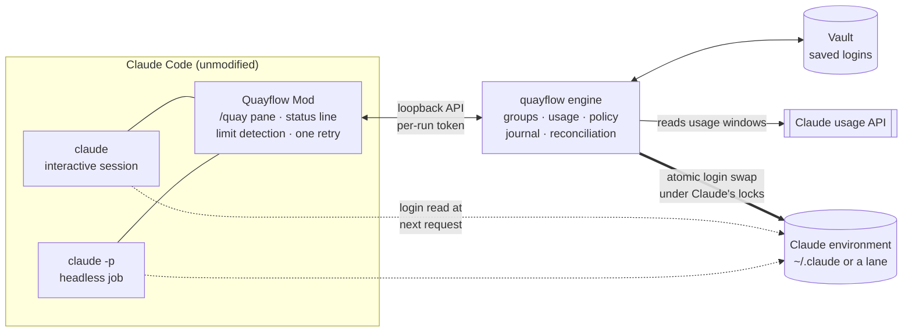
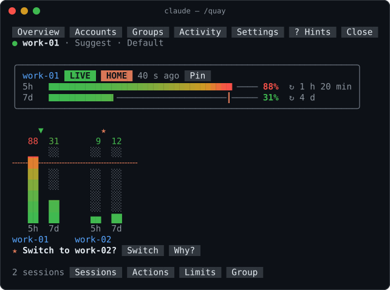
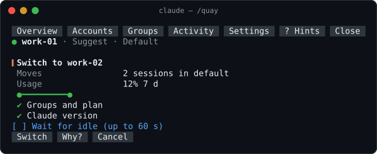

<div align="center">

<picture>
  <source media="(prefers-color-scheme: dark)" srcset="assets/brand/quayflow-logo-dark.png">
  
</picture>

**Run Claude Code across your own accounts without stopping.**<br/>
When one account reaches its usage limit, your session or `claude -p` job continues on the next one,<br/>
in place: same conversation, same process, no restart, nothing replayed.

[](https://github.com/minhdaohuu/quayflow/actions/workflows/ci.yml)
[](https://github.com/minhdaohuu/quayflow/releases)
[](LICENSE)


[Why](#why-quayflow) · [Contract](#the-contract) · [Install](#install) · [Quick start](#quick-start) · [Headless jobs](#headless-jobs) · [How it works](#how-it-works) · [FAQ](#faq) · [Docs](#documentation)



</div>

> [!IMPORTANT]
> Use only accounts that are yours to use, and follow your provider's terms and your organization's rules. Quayflow is an independent open-source project, **not affiliated with or endorsed by Anthropic**. More in [Safety](#safety).

## Why Quayflow

If you have more than one Claude subscription, for example a work seat and a personal plan, each has its own 5-hour and weekly windows. When one runs out, the usual fix is `/login` and a browser sign-in, by hand, at the moment you notice. An unattended job cannot do even that: it fails.

|  | `/login` by hand | Quayflow |
|---|---|---|
| Interactive session hits its limit | The request fails; you sign in again in the browser and repeat it | In Automatic mode: the same request is retried once on an account with room, and the answer arrives. You do nothing |
| Session near its limit | You notice late | Automatic switches before the wall (85% by default); Suggest asks first |
| Which account to use | You check each one's usage yourself | Fresh usage of every account, side by side; suggestions follow your groups and ranks |
| `claude -p` job hits the limit | Fails with exit code 1 | One switch, one retry, normal answer, exit code 0 |
| Several jobs hit it at once | All fail | One shared switch; each job retries once |
| Every account is at its limit | Claude's message | The same message and exit code, untouched, plus `quayflow last` telling your script when to run again |

Three things set it apart:

- **In place.** No wrapper, no launcher, no proxy. You keep typing `claude` and `claude -p`. Quayflow swaps the login under Claude's own locks between requests and then checks that the next request really used the new account.
- **Built for unattended work.** A headless run's stdout, stderr and exit code are always Claude's own. Nothing prompts, nothing hangs, at most one retry, never a replay.
- **You stay in control.** Groups say which accounts may serve which projects. Automatic is approved once per group; until then Quayflow only suggests (Suggest mode) or does nothing (Manual). Fresh usage only: a reading that is out of date never counts as room.

## Same job, two outcomes

The same `claude -p` command, started while the live account is at its weekly limit:

<table>
<tr><th>Without Quayflow</th><th>With Quayflow (group in Automatic)</th></tr>
<tr><td>

```text
$ claude -p "Summarize the open PRs" \
    --output-format json
{"type":"result","is_error":true,
 "result":"You've hit your weekly limit
 · resets 11am", ...}
$ echo $?
1
```

</td><td>

```text
$ claude -p "Summarize the open PRs" \
    --output-format json
{"type":"result","is_error":false,
 "result":"Three PRs are open: ...", ...}
$ echo $?
0
```

</td></tr>
</table>

Abridged; the full run is under [Headless jobs](#headless-jobs). Quayflow moved the login to an account with room and retried that one request inside the same run. The JSON is Claude's own, untouched.

## The contract

What Quayflow guarantees, and where each guarantee is tested:

1. **A headless run's stdout, stderr and exit code are always Claude's own.** Quayflow prints nothing and asks nothing in `claude -p`. Real runs: [`real-headless.ps1`](tests/e2e/real-headless.ps1) X1 to X5.
2. **One switch and at most one retry per failed request**, and only on a confirmed usage limit. Engine test `recovery_automatic_switches_once_and_retries_once`.
3. **Concurrent failures share one switch.** Real run X2: three parallel jobs, one switch, every job answers.
4. **Never a replay.** Completed work is never re-sent; a cancelled request is never recovered. Engine test `crash_reconciliation_never_replays`.
5. **Stale is never zero.** A usage reading past its freshness limit counts as unknown, never as room. Policy test `stale_is_never_zero`.
6. **When every account is at its limit, it stops.** It moves to the account available soonest and does not retry. Engine test `all_exhausted_switches_to_soonest_without_retry`.
7. **Every switch is verified.** If a client's next request did not use the new account, in-place switching turns off for that Claude version. Engine test `adoption_mismatch_disables_in_place_for_the_version`.
8. **Fails open.** With the engine stopped or not installed, Claude behaves exactly as without Quayflow. Real run X4.

All results, with dates and builds: [acceptance results](docs/acceptance.md).

### What Quayflow never does

- Never sees your password: accounts are added through Claude's own sign-in window.
- Never proxies or rewrites Claude's traffic, and never wraps the `claude` command.
- Never sends prompts, responses, tool content or tokens anywhere, and has no telemetry.
- Never shares an account between people or pools usage.
- Never gets around an organization's managed-login rules.

## Install

You need Claude Code. No administrator rights.

**Windows 10/11 x64** (PowerShell):

```powershell
irm https://github.com/minhdaohuu/quayflow/releases/latest/download/install.ps1 | iex
```

**Linux x86_64** (glibc 2.35 and OpenSSL 3 or newer: Ubuntu 22.04, Debian 12, Fedora 36 and later), and **macOS** (Apple silicon and Intel) from v0.1.6:

```sh
curl -fsSL https://github.com/minhdaohuu/quayflow/releases/latest/download/install.sh | sh
```

The installer shows what it will do and asks first. It checks every file against the release's `SHA256SUMS` and its GitHub build-provenance attestation (this needs the [GitHub CLI](https://cli.github.com/), signed in). It installs the engine for your user and adds the Quayflow Mod, a Claude Code plugin, from the same release. Running it again upgrades; `quayflow update` does the same later.

Prefer to read before you run? [Download, verify, read, then run](docs/verify-release.md). All options: [user guide › Install](docs/user-guide.md#install).

| Platform | Status |
|---|---|
| Windows x64 | Supported. Switching, real usage-limit recovery and headless jobs tested end to end with real accounts. |
| Linux x86_64 | Supported from v0.1.5, **not fully tested**: switching, lanes and headless jobs ran with real accounts on Ubuntu 24.04; real usage-limit recovery and an install from a published release have not run yet. |
| macOS | Supported from v0.1.6 (Apple silicon and Intel), **not fully tested**: on an Apple silicon Mac, switching, lanes and recovery from a simulated usage limit passed with real accounts; real usage-limit recovery, Intel Macs and an install from a published release have not run yet. Claude Code keeps its login in the Keychain there, and Quayflow switches it through `/usr/bin/security`. |

Details: [acceptance results](docs/acceptance.md).

## Quick start

1. Start Claude as usual: `claude`.
2. Type `/quay`. The welcome screen asks you to start the engine and to accept the terms reminder.
3. **Register** the login you are signed in with, and allow Quayflow to keep it in its vault. It joins the `Default` group.
4. **Add account.** A window opens with Claude's own sign-in. Quayflow never sees a password or asks for a token.
5. **Turn on Automatic** for the group. Quayflow asks you to approve it once:

   ```text
   /quay mode automatic
   ```

   (or `quayflow mode automatic --group Default --approve` from a terminal or a script.)

6. Keep working. The status line shows the live account and its usage:

   ```text
   Quayflow · work · Automatic · 5h 97% · 7d 40%
   ```

   Near the threshold (85%) Quayflow switches to the account with the most room. If a request hits the limit first, it switches and retries that request once. Either way your next answer arrives in the same session, and the transcript says what happened:

   ```text
   ● quayflow: Quayflow: Switched to personal (usage-limit recovery).
   ```

Prefer to decide each time? Leave the group in Suggest, the default: the status line then says `| personal suggested` and `/quay accept` switches.

Everything in the pane also works from the command line: `quayflow status`, `quayflow use <account>`, `quayflow group ...`. See the [user guide](docs/user-guide.md).

## Headless jobs

Scheduled tasks, scripts and agent pipelines that run `claude -p` get the same switching and recovery, and Quayflow stays invisible to them.

A job started while the live account `sdk` is at its weekly limit:

```sh
claude -p "Reply with exactly: HEADLESS-OK" --output-format json
```

returns Claude's normal JSON with exit code 0: Quayflow switched to `personal` and retried that request once inside the run. The engine log of such a recovery:

```text
19:53:44 failure.shape      seven_day 100%, simulated: false     <- Claude reports the limit
19:53:44 transition.written sdk -> personal, how: recovery, lockedMs: 17
19:53:44 recovery.decision  retry: true, switched: true          <- one switch, one retry
19:53:51 adoption           used: personal, ok: true             <- the retry ran on personal
```

When Quayflow does not switch (every account is at its limit, or the group is not in Automatic), the job gets Claude's own result, unchanged. Your script asks what happened with the `session_id` from Claude's output:

```text
$ quayflow last --session a04910ad-30f6-4c2a-8bd8-94a317333a02
Session a04910ad-30f6-4c2a-8bd8-94a317333a02: not recovered
  limit:        sdk at 100% 7d (resets 2026-11-08T04:00:00.000Z)
  run again at: 2026-11-08T04:00:00.000Z
  why:          Suggest mode: no automatic switch; /quay accept switches to personal
```

`--json` gives the same as `recovered`, `all_exhausted` or `not_recovered`, with `availableAt`.

<details>
<summary><b>Recipes: nightly jobs and self-healing agent loops</b></summary>

Every recipe assumes the group is in Automatic mode (`quayflow mode automatic --group Default --approve`).

A nightly job (cron):

```sh
# m h dom mon dow
0 2 * * * cd ~/src/app && claude -p "Triage new issues and label them" --output-format json >> ~/jobs/triage.jsonl
```

A loop that waits when every account is at its limit and runs again (POSIX shell, needs `jq`):

```sh
while :; do
  out=$(claude -p "$TASK" --output-format json) && { printf '%s\n' "$out"; break; }
  at=$(quayflow last --session "$(printf '%s' "$out" | jq -r .session_id)" --json | jq -r .availableAt)
  [ "$at" = null ] && { printf '%s\n' "$out"; exit 1; }   # not a usage limit: stop
  sleep $(( $(date -d "$at" +%s) - $(date +%s) + 60 ))
done
```

The same in PowerShell:

```powershell
while ($true) {
  $out = claude -p $Task --output-format json
  if ($LASTEXITCODE -eq 0) { $out; break }
  $at = (quayflow last --session ($out | ConvertFrom-Json).session_id --json | ConvertFrom-Json).availableAt
  if (-not $at) { $out; exit 1 }                                  # not a usage limit: stop
  Start-Sleep -Seconds ([int]([datetime]$at - (Get-Date)).TotalSeconds + 60)
}
```

</details>

What Quayflow promises a pipeline:

- **Byte-for-byte output.** Nothing from Quayflow reaches stdout or stderr, and the exit code is Claude's. Parsers and dashboards built for plain `claude -p` keep working.
- **No prompts, no hangs.** Approvals are given once, ahead of time.
- **Bounded.** One switch and at most one retry per failed request. Never a replay of completed work, never a second process.
- **Fails open.** With the engine stopped or not installed, `claude -p` behaves exactly as without Quayflow.

Tested on Windows with real accounts and a real weekly limit by [`tests/e2e/real-headless.ps1`](tests/e2e/real-headless.ps1): 42 of 42 checks, including three parallel runs sharing one switch. Setup: [Headless jobs](docs/user-guide.md#headless-jobs-claude--p).

## How it works



- **The engine** (`quayflow`) runs in the background for your user. It reads each account's 5-hour, 7-day and per-model windows (the live account every minute, idle accounts every ten minutes), decides by your groups and modes, and swaps the login atomically under Claude's own locks (the login files, or Claude's Keychain item on macOS).
- **The Mod** runs inside every Claude session. It draws the status line and the `/quay` pane, reports which account each request used, and on a confirmed usage limit asks the engine for one switch and retries that request once.
- **Every switch is verified.** If a client's next request did not use the new account, in-place switching turns off for that Claude version.
- **Lanes** keep one session on a different account in a separate environment that still links your shared Claude setup.

Type `/quay` for the pane: each account's windows with countdowns to their reset, a chart of every account against the threshold, and the suggestion.

<p align="center">
  
</p>

Accepting a suggestion opens a review before anything changes: which sessions move, the target's usage and the checks that passed.

<p align="center">
  
</p>

<sub>Rendered from the Mod's own drawing code with sample data. The desktop app and IDE panels show the same figures as text gauges.</sub>

The switch sequence and the recovery rules, step by step: [technical specification](docs/tech-spec.md#5-policy-rules-qf-policy).

## FAQ

**Is this allowed?** Quayflow switches between accounts that are yours, the same as signing in again by hand, only faster. It does not share accounts, pool usage between people or get around a provider's limits: when every account is at its limit, it stops. Whether using several subscriptions fits your provider's terms and your employer's rules is your call; organization-managed login rules are detected and respected.

**Why not just run `/login`?** `/login` needs you at the keyboard and a browser sign-in each time, and it cannot help a `claude -p` job that is already running. Quayflow keeps every account signed in, watches their usage, and switches between two requests of the running process.

**Does it read my prompts?** No. The Mod sends the engine opaque ids, the labels and group names you typed, usage percentages and the project folder path. Never prompt, response or tool content, never tokens.

**Where are my logins?** On your computer only: encrypted with DPAPI on Windows; owner-only files (`0600`) on Linux and macOS (on Linux the same protection Claude Code gives its own login; on macOS Claude Code itself uses the Keychain). No telemetry, no server.

**What if the engine is down?** Claude works as usual. The status line says so, and headless runs are untouched.

**Does a switch break the prompt cache?** The cache is per account, so the first request after a switch reprocesses the conversation once.

## Safety

- **Terms and organization rules are your responsibility.** Use only accounts that are yours to use.
- **A switch moves every session of an environment** (by default `~/.claude`), each at its next request. Use lanes to keep a session on a different account.
- **Saved logins** are protected for your user (DPAPI on Windows; `0600` files on Linux and macOS, not encrypted). Neither protects against malware running as you. Claude refreshes the live login; Quayflow refreshes only an idle account's saved copy, so its usage stays readable. Logins never go into logs, reports or the Mod.
- **Releases are not code-signed.** They are reproducible, hashed and, from v0.1.5 on, attested. Smart App Control and signed-only company policies may block them. See [Verifying a release](docs/verify-release.md).

Read [Known limits](docs/known-limits.md) before relying on Quayflow for unattended work, and [Security notes](docs/security.md) for what it touches.

## Documentation

| | |
|---|---|
| [User guide](docs/user-guide.md) | Install, groups, modes, recovery, headless jobs, lanes, troubleshooting, update, uninstall |
| [Security notes](docs/security.md) | What Quayflow touches, the vault, logs, the loopback API, managed login |
| [Verifying a release](docs/verify-release.md) | Hashes, attestations, reproducible builds |
| [Known limits](docs/known-limits.md) | Scope, undocumented dependencies, open release conditions |
| [Technical specification](docs/tech-spec.md) | Paths, schemas, API v1, CLI, policy rules |
| [Acceptance results](docs/acceptance.md) | What is proven, on which platform and build |
| [Changelog](CHANGELOG.md) | Release history |

## Roadmap

- **Now (v0.1, public pilot):** Windows x64, Linux x86_64 and macOS. The remaining [acceptance scenarios](docs/acceptance.md) close the pilot.
- **Next:** lanes for unattended jobs with their own mode, so background jobs can switch without moving your interactive sessions.
- **Later:** an encrypted vault on Linux (desktop keyring) and macOS (Keychain); same-terminal Replace for bash and zsh; code signing.

Have a use case that is not covered? [Open an issue](https://github.com/minhdaohuu/quayflow/issues/new/choose).

## Contributing

Contributions are welcome. [CONTRIBUTING.md](CONTRIBUTING.md) covers building from source on Windows, Linux and macOS, the test suites and the repository layout. Quayflow handles login files, so changes are held to a high bar for safety and honest evidence. Please follow the [Code of Conduct](CODE_OF_CONDUCT.md), and report security problems privately as described in [SECURITY.md](SECURITY.md).

## License

[MIT](LICENSE). "Claude" and "Claude Code" are trademarks of Anthropic, PBC, used here only to describe compatibility.
