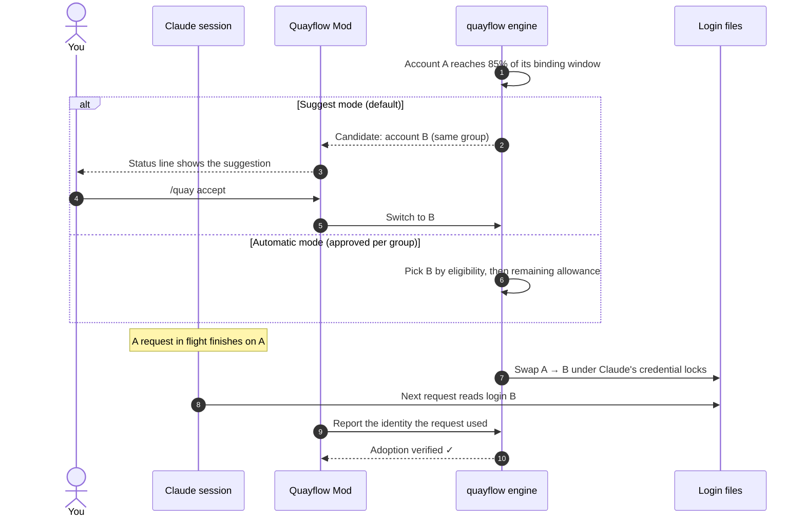
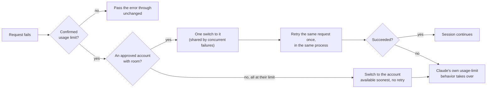

# Quayflow v0.1 technical specification

> Scope: this specification describes v0.1 on Windows x64, Linux x86_64 and macOS as of v0.1.6. Paths are given for Windows; [section 1a](#1a-linux) lists what differs on Linux and [section 1b](#1b-macos) macOS. Platform-specific parts (vault protection, paths and locks, process facts, shell integration, installer) are isolated behind module boundaries. See [requirements.md](requirements.md#platform-scope). Linux is not fully tested; see [Known limits](known-limits.md#platform-and-scope).

Companion to [requirements.md](requirements.md). This file holds the engineering details: paths, schemas, constants, routes, commands, and the results of the early checks.

## 1. Components and files

| Component | Source | Installed as |
|---|---|---|
| Engine and CLI | `crates/quayflow` (bin `quayflow`) | `%LOCALAPPDATA%\Quayflow\bin\quayflow.exe` (console subsystem) |
| Background launcher | `crates/quayflow` (bin `quayflow-bg`) | `%LOCALAPPDATA%\Quayflow\bin\quayflow-bg.exe` (windows subsystem; used by the sign-in startup entry so no console appears) |
| Mod | `mod/quayflow` | plugin `quayflow` from marketplace `quayflow` (this repository, `.claude-plugin/marketplace.json` at the root) |
| PowerShell integration | `shell/Quayflow.psm1` (embedded in `quayflow.exe`) | written to `%LOCALAPPDATA%\Quayflow\shell\Quayflow.psm1` by `quayflow shell install` |
| Installer | `installer/install.ps1`, `installer/install.sh` | GitHub Release assets |

## 1a. Linux

| Topic | Linux |
|---|---|
| Program | Release asset `quayflow-linux-x86_64`, installed as `~/.local/share/quayflow/bin/quayflow` and linked as `~/.local/bin/quayflow`; no `quayflow-bg` (no console window to hide) |
| Data folder | `$XDG_DATA_HOME/quayflow`, default `~/.local/share/quayflow`, made `0700` (`qf_engine::paths::default_root`) |
| Vault | `vault/<account-id>.login`: base64 of `{"oauth": ..., "account": ...}`, no encryption, `0600` (`qf_vault::OwnerOnly`); backups of an unknown login are `backups/unknown-<hash>-<ts>.login` in the same form |
| File writes | `qf_vault::atomic_write` creates the temp file with the target's mode, or `0600` for a new file |
| Single instance | `flock` on `engine.lock` (`File::try_lock`) |
| Process facts | `/proc/<pid>/stat` (parent, start time from `btime` + start ticks), `/proc/<pid>/comm` (macOS: §1b) |
| Engine start | `quayflow start` spawns `quayflow serve` in its own process group |
| Claude's locks | The same `mkdir` directory locks; a lock's mtime is set through a read-only directory handle |
| Lanes | Folder links are symbolic links (junctions on Windows); shared files are hard links |
| Managed settings | `/etc/claude-code` (`managed-settings.json`, `managed-settings.d`) |
| Sign-in startup | systemd user unit `~/.config/systemd/user/quayflow.service` (`Type=oneshot`, `RemainAfterExit=yes`, `ExecStart=<program> start`) |
| New console | First of `x-terminal-emulator`, `gnome-terminal`, `konsole`, `xfce4-terminal`, `xterm`, with the engine's own desktop variables when they name a display, or else those the latest interactive session sent in `/v1/hello` (`desktop`, kept in memory only). The variables are listed in `qf_adapter::process::DESKTOP_VARS`: `DISPLAY`, `WAYLAND_DISPLAY`, `XDG_RUNTIME_DIR`, `DBUS_SESSION_BUS_ADDRESS`, `XAUTHORITY`, `XDG_CURRENT_DESKTOP`, `XDG_SESSION_TYPE`, `XDG_SESSION_DESKTOP`, `DESKTOP_SESSION`, `XDG_DATA_DIRS`, `XDG_CONFIG_DIRS`, `BROWSER`; otherwise the caller shows the command (POSIX syntax on Linux) |
| Shell integration | None yet (the prompt hook is PowerShell) |
| Mod | Finds the engine through `$XDG_DATA_HOME` or `$HOME` when `LOCALAPPDATA` is not set (`hooks/engine.ts` `layout`) |
| Installer, update | `install.sh` (POSIX `sh`); `quayflow update` runs `sh install.sh --update ...` |

## 1b. macOS

macOS is supported from v0.1.6 (Apple silicon and Intel). This section records what Claude Code does there and how Quayflow switches. Sources: the JavaScript bundled in Claude Code 2.1.319 (`~/.local/share/claude/versions/<v>`), loopback tests with fake tokens (2026-11-08), and a survey of other account switchers that read the same internals. With real logins on an Apple silicon Mac: `tests/e2e/real-macos-keychain.py` 19/19, `real-switching.ps1` 13/13 and `real-lanes.ps1` 8/8 ([acceptance.md](acceptance.md)).

### Claude Code on macOS (2.1.319, observed)

| Topic | Fact |
|---|---|
| Login store | Keychain generic password, not `.credentials.json`. Service `Claude Code-credentials` for the default environment. With `CLAUDE_SECURESTORAGE_CONFIG_DIR` (empty: unsuffixed) or else `CLAUDE_CONFIG_DIR`: `Claude Code-credentials-<first 8 hex of sha256(value)>`. The value is NFC-normalized but not resolved: a trailing slash or a symlinked path gives another item, and `CLAUDE_CONFIG_DIR=~/.claude` gives the suffixed name. Account: `$USER`, or `claude-code-user` when it has characters outside `[a-zA-Z0-9._-]` |
| Payload | One JSON object: `claudeAiOauth` plus other keys (`mcpOAuth`, `mcpOAuthClientConfig`, `pluginSecrets` and others). Written as hex: `security -i` with `add-generic-password -U -a … -s … -X <hex>` on stdin (argv above 4032 characters); read with `security find-generic-password -w`. `oauthAccount` stays in `.claude.json` |
| Fallback | Reads the Keychain first and `.credentials.json` (in the same folder) only when the Keychain gives nothing. On a write the Keychain refuses outright, writes `.credentials.json` instead. No migration from the file into the Keychain |
| Read cache | Keychain reads are cached for 30 s in each process; a failed read serves the cached copy |
| Re-read before a request | Claude stats `<configDir>/.credentials.json`. Missing: re-read through the 30 s cache. Mtime changed: clear the cache and re-read at once. Present and unchanged: no re-read until the token is unusable. Measured: without the file a switch reached a running `claude -p` after 20 to 32 s; with the file created or touched, at the next request (about 1 s) |
| Refresh | Clears the cache and re-reads before refreshing and again under `.oauth_refresh.lock`; it never refreshes with a stale cached refresh token |
| Locks | `.oauth_refresh.lock` (stale 60 s, touched every 5 s) and the legacy `<realpath(configDir)>.lock`; `<configDir>/.storage-write.lock` (stale 15 s) around every write to the login store, given up after about 7.5 s; `<claude.json>.lock`. `.storage-write.lock` is the same on Windows and Linux; Quayflow takes it on every platform |
| Managed policy | `/Library/Application Support/ClaudeCode` (`managed-settings.json`, `managed-settings.d`), and the MDM plists `/Library/Managed Preferences/<user>/com.anthropic.claudecode.plist` and `/Library/Managed Preferences/com.anthropic.claudecode.plist`, read through `plutil -convert json` |
| Sessions | `sessions/<pid>.json` as elsewhere, plus `procStart` (`ps -o lstart`, UTC) and `pidDomain: "darwin"`. Process name `claude`; binary in `~/.local/share/claude/versions/<v>` |

### Quayflow on macOS

| Topic | macOS |
|---|---|
| Login store | `qf_adapter::login::store`: the environment's Keychain item when it exists (`keychain::find`), else `.credentials.json` (an environment without an item, such as a new lane or a Mac where Claude's Keychain write failed, is switched as on Linux; Claude moves it into the Keychain at its next save). The bare service is used only for the real user's `~/.claude`, with the home folder from the account database (`getpwuid_r`), never `$HOME`: tests and fake environments with another home stay file-backed. `QUAYFLOW_KEYCHAIN=off` keeps every environment file-backed |
| Keychain access | `qf_adapter::keychain`, through `/usr/bin/security` only, by absolute path, with `-U` and never `-T`/`-A`. Never the Security framework: `SecItemUpdate` moves Claude's item out of the `apple-tool:` partition and Claude then meets a Keychain dialog. The account is taken from the existing item. Secrets go on stdin (`security -i`), never argv; a payload above 4032 characters is refused. A call that takes over 5 s (a dialog) is ended and reported |
| Switch | `login::swap_with` → `swap_keychain`, under `.oauth_refresh.lock`, the legacy lock, `.storage-write.lock` and `<claude.json>.lock` (measured 0.07 s): read the item and keep the outgoing login (possibly just refreshed by Claude); replace only `claudeAiOauth`, keep every other key; write; read back and compare (a mismatch fails the switch); update `oauthAccount` (if that fails, the item is written back); write the marker |
| Marker | `<configDir>/.credentials.json` holding the same merged login, mode `0600`, atomic rename. It makes every running session re-read at its next request, so the one recovery retry runs on the new account. `login::sweep_marker`, called from the engine's tick, removes it once it is 35 s old, under the storage lock, and only if its bytes are the ones this engine wrote or equal the Keychain item (Claude may have saved its own fallback there); the second rule also clears leftovers of an earlier engine run. The marker holds the real login rather than `{}`: while it exists, a failed Keychain read falls back to it |
| Environment identity | Quayflow writes the item named from the folder string it knows: for lanes and sign-in folders the string it sets, for the default environment the engine's own `CLAUDE_CONFIG_DIR`. The Mod sends the session's `CLAUDE_CONFIG_DIR` and `CLAUDE_SECURESTORAGE_CONFIG_DIR` exactly as set in `/v1/hello` (`configDir`, `secureStorageDir`; not logged). The engine computes the item that session reads (`keychain::session_service`) and, for a session listed in an environment's registry that reads another item or uses a separate login store, shows the notice `keychain_mismatch` with the exact variable to use (`Engine::keychain_mismatch`). Such a session's adoption report is not evidence against the Claude version: its pending adoption is dropped |
| Sign-in | `claude auth login` under a temporary `CLAUDE_CONFIG_DIR` writes a suffixed Keychain item; Quayflow reads it from there, and `login::retire` removes `claudeAiOauth` from it (deleting the item when nothing else is in it) |
| Idle refresh | The check "no environment holds the same refresh token" reads every environment through `read_login`, so Keychain items included |
| Vault | Owner-only files as on Linux (`qf_vault::OwnerOnly`); a Keychain-backed vault under Quayflow's own service may follow |
| Canary | Also requires `OAUTH_FILE_SUFFIX` (the service name is assembled at run time), `find-generic-password`, `add-generic-password` and `.storage-write` (`canary::MACOS_MARKERS`; present in 2.1.311, 2.1.317 and 2.1.319). As on every platform, each running session's own version (from its registry entry, not the installed one) must pass |
| Process facts | `proc_pidinfo(PROC_PIDTBSDINFO)` for parent, start time and name; `kill(pid, 0)` for liveness (`/proc` does not exist) |
| Data folder | `~/.local/share/quayflow`, as on Linux, so the Mod's `layout` needs no change |
| Sign-in startup | LaunchAgent `~/Library/LaunchAgents/com.quayflow.engine.plist` (`RunAtLoad`, `AbandonProcessGroup`, runs `quayflow start`), loaded with `launchctl bootstrap gui/<uid>` and removed with `bootout`. The engine must run in the user's login session to use the Keychain (not over SSH, not as a daemon) |
| New console | `open -a Terminal` with a `.command` script in the temporary folder (mode `0700`; sets the variables and folder, removes itself, `exec`s the program; holds no secret) |
| Release | `quayflow-macos-arm64` and `quayflow-macos-x86_64`, both built on one `macos-15` runner, twice, and compared. The linker's ad-hoc signature is enough for a `curl` install (no quarantine flag); `install.sh` removes the flag from a verified copy of a browser download. `install.sh` picks the asset by `uname`, uses `shasum -a 256` when `sha256sum` is missing, and finds the running engine with `ps` |

## 2. Data folder `%LOCALAPPDATA%\Quayflow`

Tests can move the whole folder with `QUAYFLOW_HOME`.

| Path | Content |
|---|---|
| `bin\` | `quayflow.exe` and `quayflow-bg.exe` as installed |
| `shell\` | `Quayflow.psm1` written by `quayflow shell install` |
| `update\` | Temporary download folder of `quayflow update` (`SHA256SUMS`, `install.ps1` or `install.sh`); removed after each run |
| `config.json` | `qf_model::Config` (accounts metadata, groups, projects, tuning, consents, managed-login override setting). No credentials |
| `vault\<account-id>.dpapi` | Base64 of a DPAPI blob (CurrentUser, entropy `quayflow-vault-v1`, `CRYPTPROTECT_UI_FORBIDDEN`) of `{"oauth": <claudeAiOauth>, "account": <oauthAccount>}` |
| `backups\unknown-<hash>-<ts>.dpapi` | Protected backup of an unknown live login taken before a manual switch |
| `observations.json` | Last usage observation per account with timestamps, and poll schedule state |
| `journal.jsonl` | Durable journal (switches, recovery decisions, policy overrides, unresolved operations); fsync before a transition write. Read by `quayflow last` (section 7) |
| `logs\quayflow-YYYYMMDD.jsonl` | Sanitized structured log; 7 days, 20 MB per day cap |
| `engine.json` | `{port, token, pid, protocol, version, startedAt}` for the running engine |
| `engine.lock` | Single-instance lock: holds the engine's PID and stays open without write sharing for the engine's lifetime; a sharing violation means another engine runs, and the OS releases it when a crashed engine exits |
| `engine.stopped` | Present after an intentional stop: on-demand start from the Mod is skipped until `quayflow start` is run by the user |
| `compat\<claude-version>.json` | `qf_model::CompatRecord` |
| `lanes\<name>\` | Lane credential environment (its own `.credentials.json`, `.claude.json`, `sessions\`, policy files; links to the shared setup) |
| `signin\<id>\` | Temporary sign-in environments; credential copies are retired after saving |
| `handoff\claims\<shell-pid>.json` | Pending same-terminal replacement for the PowerShell prompt hook |
| `handoff\backups\` | Destination history replaced by an advancing copy |
| `reports\` | Support reports saved by the user |

PoC data in `%USERPROFILE%\.quayflow-poc` is imported once with `quayflow migrate-poc` (consent required; plaintext entries are sealed during import and never written back as plaintext).

## 3. Claude environment facts (2.1.316, observed)

- Default environment: credentials `%USERPROFILE%\.claude\.credentials.json` (key `claudeAiOauth`), account record `%USERPROFILE%\.claude.json` (key `oauthAccount`).
- With `CLAUDE_CONFIG_DIR=X`: `X\.credentials.json` and `X\.claude.json`.
- Locks (proper-lockfile directory locks; mkdir is the mutex; holders touch about every 5 s): refresh `<configDir>\.oauth_refresh.lock` (stale 60 s), legacy `<configDir>.lock` (stale 60 s; Claude names it after the resolved folder, and so does Quayflow on Linux and macOS), storage `<configDir>\.storage-write.lock` (stale 15 s; held around every write to the login store), config `<claude.json>.lock` (stale 10 s). Quayflow takes them in that order, waits up to `lockWaitS` (9 s) per lock, never removes a lock younger than its stale age, touches held locks every 2 s, and releases in reverse order.
- Session registry: `<configDir>\sessions\<pid>.json` with `pid, sessionId, cwd, version, kind, status (busy|idle|...), name`.
- Managed policy: registry `HKLM\SOFTWARE\Policies\ClaudeCode` and `HKCU\SOFTWARE\Policies\ClaudeCode` value `Settings` (JSON string); files `C:\Program Files\ClaudeCode\managed-settings.json` and `managed-settings.d\*.json`; server-managed settings stored as `<configDir>\remote-settings.json`. Keys `forceLoginOrgUUID` (string or array) and `forceLoginMethod` (`claudeai` or `console`).
- Usage: `GET https://api.anthropic.com/api/oauth/usage` with `Authorization: Bearer <access>` and `anthropic-beta: oauth-2025-04-20`; fields `five_hour`, `seven_day` (`utilization`, `resets_at`), `limits[]` (`scope.model.display_name`, `percent`, `resets_at`). Extra fields ignored.
- Profile: `GET https://api.anthropic.com/api/oauth/profile` (same headers) gives `account.uuid`, `organization.uuid`.
- Sign-in: `claude auth login` under `CLAUDE_CONFIG_DIR=<temp>`.
- Custom API origin (observed 2026-11-02 against a loopback fake): with a subscription login, `ANTHROPIC_BASE_URL` redirects inference requests (`POST /v1/messages?beta=true`, streaming, `Authorization: Bearer <access token>`, `anthropic-beta` including `oauth-2025-04-20`). With `CLAUDE_CODE_DISABLE_NONESSENTIAL_TRAFFIC=1`, one `claude -p` turn made exactly one request to the fake.
- Usage-limit recognition (same observation): a `429` is reported as the subscription limit ("You've hit your 5-hour limit · resets …") only when the unified headers say so: `anthropic-ratelimit-unified-status: rejected`, `-representative-claim: five_hour`, `-5h-status: rejected`, `-5h-utilization`, `-5h-reset` (epoch seconds), `-overage-status: rejected`. Without them Claude reports "Server is temporarily limiting requests (not your usage limit)". `claude -p` did not retry the 429 itself.

## 4. Identity and classification

- Account id: first 12 hex characters of SHA-256 of `oauthAccount.accountUuid`. The Mod computes the same hash from the profile endpoint's `account.uuid`.
- Organization hash: same function over `organizationUuid`.
- Kind: `organization` when `claudeAiOauth.subscriptionType` is `team` or `enterprise`, else `personal`.
- Mixed identities: an organization account together with a personal one, or organization accounts of different organizations.

## 5. Policy rules (qf-policy)

- Governing groups of an environment: the groups that the running sessions' projects resolve to (FR-05); the default group when no session runs. Candidates must be members of every governing group. Effective mode: the most restrictive (manual < suggest < automatic). Threshold: the lowest; margin: the largest; home: only when all governing groups name the same Preferred account.
- Binding window: the fullest of 5 h, 7 d and the per-model weekly window matching the session's model (all per-model windows when the model is unknown).
- Freshness: live account 5 min, idle accounts 60 min (B2: an idle observation is never treated as guaranteed capacity; its age is shown).
- Eligibility explanation per account (`Exclusion`, in this order): live; not in group or group conflict (naming the session); managed login; health (refresh rejected, vault error); plan cannot serve the model; no observation or stale; at its limit (binding >= `hardLimitPct`, 99%: "at its limit (100% 7d)"); no room to gain (binding above threshold - margin). An account that passes all of them is eligible.
- Proactive trigger: live binding >= threshold; candidate binding <= threshold - margin; cooldown 5 min between proactive switches.
- Ranking: lowest binding first; among candidates within 10 points of the best, rank order Preferred < Normal < Backup decides; ties by binding.
- Pin: a manual switch pins until unpin, binding reset of the pinned account, or 2 h; released at 98% of a window.
- Return home: live != home, home fresh and <= threshold - margin, not pinned, cooldown passed.
- Hard limit: confirmed when the session's own rate limit (or a fresh engine observation) is >= 99%. Generic errors never switch.
- Recovery target: eligible member with the most remaining allowance below 99%; otherwise the soonest-available account (availability = latest reset among its exhausted windows that apply to the session's model; unknown reset times are not ranked). The soonest account is chosen only when it opens before the live account's own known reset; otherwise nothing is switched and Claude's own wait applies. Concurrent failures within 30 s retry on the account already switched to, if it is still live.
- All accounts exhausted: switch to the soonest-available account (Automatic mode only) with **no retry** and no hold; Claude's own result for that request stands. A request is recovered at most once, and a session's next recovery needs task progress since the previous one.
- Each recovery decision is journaled as `recovery.decision` with `session`, `from` (the account the failed request used), `retry`, `switched`, `to`, `why` and `availableAt` (when every account is exhausted: when the chosen account becomes available). `failure.shape` records the failed request's rate limits.
- `model_not_found` (or a model-unavailable error) on the first request after a switch marks the model unavailable for that account and switches back; that is the incident's single recovery. An authentication failure (`auth`) right after a switch sets the account aside (refresh rejected) and switches back the same way.
- One login is never live in two environments at once (both clients would refresh the same token); such a switch is refused.

**Headless contract (owner requirement):** Quayflow never changes the stdout, stderr or exit code of `claude -p`. The Mod prints nothing in a headless run and never asks a question. Recovery in a job happens only in Automatic mode, and only as one switch and at most one retry of the failed request in the same process. A job learns afterwards what Quayflow did with `quayflow last --session <id>` (section 7).

**Usage polling (`qf_provider::Schedule`, defaults in `qf_model::Tuning`):** live account every 60 s (`livePollS`), idle accounts every 600 s (`idlePollS`); the minimum outside simulation is 30 s live and 60 s idle. A 429 from the usage endpoint waits the longer of `Retry-After` and a doubling wait (2, 4, 8 min, ...), at most 15 min (`backoffMaxS`), and puts the account on a slower pace for 1 hour: the live account is then read every 2 min (twice `livePollS`), because the endpoint's budget is per login and shared with Claude Code. An expired idle token that could not be refreshed is tried again after 10 min; other errors after `livePollS`. A forced read (`POST /v1/poll`, a refresh from `/quay`) does not cut a backoff or the slower pace short. A single 429 is logged as `info`; 429s in a row (a backoff past its first doubling) and other errors as `warn`. After an engine restart the first read of each account waits at least 1 min after its last observation. Accounts with a rejected refresh token are not polled.

**Idle-account refresh (owner decision, 2026-11-07):** an idle account's access token expires after some hours, so the engine refreshes its saved copy (`Engine::refresh_idle`): `POST https://platform.claude.com/v1/oauth/token` with `grant_type=refresh_token`, Claude Code's public client id and the login's own scopes. It runs under `cred_lock` (the lock every switch holds while writing), only when no environment's login files hold the same refresh token (read from disk, any unreadable file skips the refresh), and stores the result before use; the switch reads the saved login again under that lock. `invalid_grant` or 401/403 sets the account to `refresh_rejected` (a notice asks for a new sign-in; the account is no longer polled or a candidate); a refreshed login that cannot be stored sets `vault_error`; other failures leave it unchanged and it shows no usage until a later poll succeeds. The journal records `login.refreshed` or `login.refresh_rejected` with the account id only. The live login is never refreshed by Quayflow.

**A switch, step by step.**



**When a request hits a usage limit.** In Suggest mode the switch is only suggested; in Manual mode nothing is switched. Either way Claude's own result stands.



## 6. API v1

Loopback `127.0.0.1:<port>`, header `x-quayflow-token: <token>` from `engine.json`. JSON bodies, camelCase, schemas in `crates/qf-model/src/api.rs`. Errors: HTTP 4xx/5xx with `{"error": "...", "code": "..."}`. Codes: `bad_token` (403), `invalid` (400; 413 for a body over 64 KB), `not_found` (404), `refused`, `needs_disclosure`, `needs_approval`, `in_progress` (409), `vault`, `internal` (500). A refused switch is not an error: `SwitchResponse` has `ok: false` with `message` and `blockedBy`. Mutating requests may carry `requestId`. A repeat of a successful request among the last 256 ids returns the first response without running again; a failed request releases its id, so a repeat runs; a repeat while the first is still running gets 409 `in_progress`.

| Method and route | Body / query | Response |
|---|---|---|
| `POST /v1/hello` | `HelloRequest` | `HelloResponse` (protocol 1; accepted `[1]`) |
| `GET /v1/state` | `?sessionId=&cwd=` | `StateView` |
| `GET /v1/events` | `?since=<seq>&wait=<s, max 25>` | `EventsResponse` (long-poll; past a bounded number of open long-polls it answers at once) |
| `POST /v1/onboarding` | `{"consents": {"engineStart": true, "credentialStorage": true, "terms": true, "signinStartup": false}, "complete": true}` | `OkResponse` |
| `POST /v1/accounts/register` | `{"label", "group", "env"?, "acceptDisclosure"?}` (current live login) | `AccountView` (with `note` when relevant) or error |
| `POST /v1/accounts/signin/start` | `{"reauth"?: accountId}` | `SigninStatus` (opens a new console window running `claude auth login`) |
| `GET /v1/accounts/signin/status` | `?id=` | `SigninStatus` |
| `POST /v1/accounts/signin/confirm` | `{"id", "label", "group", "acceptDisclosure"?, "asNew"?}` (`asNew`: a reauthentication that returned another identity is registered as its own account) | `OkResponse` |
| `POST /v1/accounts/signin/cancel` | `{"id"}` | `OkResponse` |
| `POST /v1/accounts/remove` | `{"account"}` | `OkResponse` (refused while live) |
| `POST /v1/accounts/label` | `{"account", "label"}` | `OkResponse` |
| `POST /v1/groups/create` / `delete` | `{"name"}` | `OkResponse` |
| `POST /v1/groups/members` | `{"group", "add": [...], "remove": [...], "acceptDisclosure": bool}` | `GroupChangeResponse` (`needsDisclosure` when the result would mix identities without a covering acceptance) |
| `POST /v1/groups/preferred` | `{"group", "account": id or null}` | `OkResponse` |
| `POST /v1/groups/rank` | `{"group", "account", "rank": "preferred|normal|backup"}` | `OkResponse` |
| `POST /v1/groups/mode` | `{"group", "mode", "approveAutomatic": bool}` | `OkResponse` |
| `POST /v1/groups/tuning` | `{"group", "threshold"?, "margin"?}` | `OkResponse` |
| `POST /v1/groups/default` | `{"group"}` | `OkResponse` |
| `POST /v1/projects/assign` / `unassign` | `{"path", "group"}` / `{"path"}` | `OkResponse` |
| `POST /v1/switch` | `SwitchRequest` (manual; pins) | `SwitchResponse` |
| `POST /v1/accept` | `{"sessionId"?, "env"?}` | `SwitchResponse` |
| `POST /v1/transition/cancel` | `{"id"}` | `{"ok", "message", "started"}` (`started` true when the write had already begun) |
| `POST /v1/unpin` | `{"env"?}` | `OkResponse` |
| `POST /v1/step` | `StepReport` | `StepResponse` |
| `POST /v1/adoption` | `AdoptionReport` | `OkResponse` |
| `POST /v1/recover` | `RecoverRequest` | `RecoverResponse` (`retry`, `switched`, `to`, `why`, `availableAt` when every account is exhausted); journaled as `recovery.decision` |
| `POST /v1/failure` | `FailureShape` | `OkResponse` |
| `POST /v1/unknown` | `{"env"?, "action": "ignore"}` | `OkResponse` |
| `GET /v1/lanes` | | `[LaneView]` |
| `POST /v1/lanes/create` / `check` / `delete` | `{"name"}` | `LaneView` for create and check; `OkResponse` for delete |
| `POST /v1/handoff/prepare` | `{"sessionId", "toEnv"}` | `HandoffResponse` (history copied, command only) |
| `POST /v1/handoff/open` | `{"sessionId", "toEnv"}` | `HandoffResponse` (new window launched) |
| `POST /v1/handoff/replace` | `{"sessionId", "toEnv"}` | `HandoffResponse` (claim written for the PowerShell hook; the user then exits the session) |
| `POST /v1/engine` | `{"action": "pause|resume|stop"}` | `OkResponse` |
| `GET /v1/policy` | | `{"envs": [{"env", "managed": ManagedLogin}], "dOrg"}` |
| `POST /v1/policy/dorg` | `{"enable": bool, "confirmOrg": "<org hash>", "acknowledge": "<typed text>"}` | `OkResponse` (setting recorded only; no bypass path in this build) |
| `GET /v1/compat` / `POST /v1/compat/check` | | `[CompatRecord]` |
| `POST /v1/report` | `{}` | `ReportResponse` (saved locally for review) |
| `POST /v1/report/preview` | `{}` | `ReportPreview` `{"id", "text"}` (built, not saved) |
| `POST /v1/report/save` | `{"id"}` | `ReportResponse` (saves exactly the previewed text; refused when it is not the last preview) |
| `GET /v1/explain` | `?env=&sessionId=` | `ExplainView`: each account live/eligible/excluded/unknown with reason, usage, age, exhausted and availability, endpoint backoff and next check; threshold, margin, cooldown (and time left), home state; read-only |
| `GET /v1/identity` | `?env=` or `?account=` | `IdentityView` (e-mail and organization name from the local login record or the account's protected copy; for review only, never stored or logged) |
| `GET /v1/handoff/check` | `?sessionId=&toEnv=` | `HandoffCheck` (destination login, running, shell name, PowerShell or not, prompt hook, blocker) |
| `GET /v1/operations` | `?limit=` | `[OperationView]` (recent transitions with their sanitized journal records) |
| `POST /v1/pin` | `{"env"?}` | `Pin` (pins the live account without a switch; same release rules as a manual switch) |
| `POST /v1/tuning` | `{"cooldownS"?: 0-3600, "pinMinutes"?: 5-1440}` | `OkResponse` (applies to every group) |
| `POST /v1/poll` | `{}` | `OkResponse` (observe every due account now; an account in a 429 backoff or on the slower pace after one waits for its next read) |
| `POST /v1/migrate-poc` | `{"group", "acceptDisclosure"}` | `OkResponse` (imports the PoC vault) |
| `POST /v1/canary/start` / `GET /v1/canary` / `POST /v1/canary/stop` | | Manual live canary recording (consent `liveCanary`); while active, `/v1/step` asks for identity on every request |
| `POST /v1/canary/switch` | `{"to"}` | `SwitchResponse` (switch marked `canary`, no pin) |
| `POST /v1/compat/reset` | `{"version", "livePass", "detail"}` | `CompatRecord` (record a manual canary result) |

Refusals that need an explicit user decision use HTTP 409 with `code` `needs_disclosure` (mixed-identity group; resend with `acceptDisclosure: true`) or `needs_approval` (Automatic mode; resend with `approveAutomatic: true`).

The Mod's request hook calls `/v1/step` after every main or subagent request; when the response says `verify`, it reads the identity its request used (`$.session.authorize()` handle + profile endpoint, hashed) and posts `/v1/adoption`.

Mod connection: the session's first handshake (`/v1/hello`) is tried up to three times (about 8 s at most) only while something answers or a try times out; a refused connection or a missing `engine.json` runs `quayflow start --if-consented` at once, at most once per session. After `/reload-plugins` the last link is kept until the new handshake answers. After a resume or `/clear` (a new session id without a session start) the Mod carries the link over and says hello under the new id. The pane and every `/quay` command connect when no handshake is under way, without starting the engine. `/quay` refuses an option it does not know and names the nearest known one.

## 7. CLI

`quayflow <command>`; commands that need the engine talk to it over the API.

```text
serve                          run the engine (foreground; used by start)
start [--if-consented]         start the engine without a window; prints {"state":"running|started|failed|no_consent|stopped_by_user"}
stop | pause | resume          intentional stop; pause or resume automation
status [--json]                summary of environments, accounts and usage
last --session <id> [--json]   what Quayflow did for one Claude session (see below)
onboard                        interactive first-use consents (terminal)
register --label L --group G [--accept-disclosure]   register the current login (asks for consent)
add --label L --group G [--accept-disclosure]        add another account through native sign-in in a new window
reauth <account>               sign in again for a set-aside account
remove <account> [--yes] | label <account> <new>
use <account> [--idle-wait] [--env E] | accept | unpin
mode <manual|suggest|automatic> [--group G] [--approve]
group list | create <G> | delete <G> | add <G> <account..> [--accept-disclosure] | remove <G> <account..>
      | preferred <G> <account|none> | rank <G> <account> <rank> | default <G> | tuning <G> [--threshold N] [--margin N]
project assign <path> <G> | project unassign <path> | project list
unknown ignore [--env E]       acknowledge an unregistered live login (automation stays paused)
canary [--live]                static check now; --live runs the synthetic adoption job (consent)
lanes list | create <name> | delete <name> | check <name>
handoff open|replace|prepare --session <id> --to <env>
shell install | uninstall      PowerShell prompt hook (PowerShell 7 and 5.1 profiles)
shell refresh                  rewrite an installed hook module from this version (no profile change)
shell claim --pid N            used by the prompt hook: print and consume this terminal's pending replacement
policy [--json]                managed login enforcement per environment
report [--preview]             build a local support report for review (--preview prints it and saves nothing)
migrate-poc [--group G] [--accept-disclosure]   import the PoC vault (~/.quayflow-poc)
update [--check] [--version vX.Y.Z | --source DIR] [--skip-attestation]   runs the release's installer (hash-checked): engine and Mod as a matched pair
uninstall [--delete-vault] [--delete-logs] [--delete-data] [--yes]   each deletion separate and off by default; --delete-data = vault, logs, settings and lanes
consent <engine-start|signin-startup|credential-storage|terms|prompt-hook|live-canary> <on|off>
version
```

`quayflow last --session <id> [--json]` reads `journal.jsonl` and `config.json` directly, so it works with the engine stopped. The session id is the `session_id` of Claude's JSON output. It reports the latest `recovery.decision` for that session and the `failure.shape` before it: `outcome` is `recovered` (switched and retried once, and the retry did not fail), `all_exhausted` (switched to the account available soonest, no retry), `not_recovered` (with the reason in `why`, including a retry that failed too) or `no_limit` (nothing recorded); `limit` names the account, window, percentage and reset that was hit; `switchedTo`, `retried`, `at`; and `availableAt`, the earliest time worth running again (the soonest account's availability, or the reset of the limit that was hit; empty after a recovery). Exit code 0 when something is recorded, 3 when nothing is.

`update` refuses without a signed-in GitHub CLI unless `--skip-attestation` is given, then downloads the release's `SHA256SUMS` and installer, checks the script's hash, and runs it: `install.ps1 -Update` on Windows, `sh install.sh --update` on Linux and macOS. The installer makes its full checks (hashes, attestation for the release workflow, tag and commit, the Mod's `SOURCE_COMMIT`), keeps consents and PATH, leaves a Mod installed from a local folder as it is, and refreshes an installed shell module. `--check` only compares the release's hashes with the installed programs. `--source DIR` installs a local release folder (engine only).

## 8. Early checks

| Check | Result | Chosen path |
|---|---|---|
| C1 Mod imports sibling modules | See `mod/quayflow/README.md` (recorded by the Mod build) | |
| C2 Pane with tabs, Input and Select | See `mod/quayflow/README.md` | |
| C3 Claude through lane links | Junctions (`junction` crate, no admin) for folders. Files (`settings.json`, `CLAUDE.md`) are hard links; if Claude replaces a file by rename, the link breaks: `lanes check` detects a broken link and re-links to the newer content. A real lane session passed on a local build on 2026-11-03 (owner-run, `tests/e2e/real-lanes.ps1`, 8/8) | Junctions + hard links with repair |
| C4 PoC DPAPI blobs decrypt in Rust | The PoC stored `base64(ProtectedData.Protect(utf8 JSON, entropy, CurrentUser))`; Rust `CryptUnprotectData` with the same entropy reads it (unit test round-trips the format; owner runs `quayflow migrate-poc`) | Migration supported |
| C5 Native sign-in in a temporary environment | `claude auth login` exists in 2.1.316. The engine opens it in a new console window (`CREATE_NEW_CONSOLE`) with `CLAUDE_CONFIG_DIR` set and detects completion by polling the temporary environment for `claudeAiOauth` + `oauthAccount`; the exact command is shown as a fallback | New window + detection |

## 9. Simulation mode (tests only)

`QUAYFLOW_SIM_API=http://127.0.0.1:<port>` sends the usage and profile calls (instead of `https://api.anthropic.com`) and the idle-account token refresh (instead of `https://platform.claude.com`) to a fake server. Only a loopback HTTP origin is accepted (`127.0.0.1` or `localhost`, a port, no path); any other value is ignored, so the setting cannot send a login or refresh token to another host. In simulation mode polling intervals below the normal 30 s / 60 s minimum are allowed, and `quayflow status` and `status --json` (`engine.simulation`) show that the mode is on. `QUAYFLOW_OFFLINE` disables these calls and update downloads altogether. The fake server is `tests/sim/fake_api.py` (usage, profile and token endpoints); `tests/e2e/sim-usage.ps1` drives it.

`QUAYFLOW_SIM_LIMIT=1` in the Claude process turns on the Mod's simulated-limit hook: `simulate-limit.json` in the data folder (`{"atStep": n}`) makes the first main-agent request with index >= n fail as a usage limit without being sent, once. Without the variable the file is ignored. `tests/e2e/real-switching.ps1` case R1 uses it.

## 10. Build notes

- Local development on a machine without Visual Studio Build Tools: `RUSTUP_TOOLCHAIN=1.98.0-x86_64-pc-windows-gnu` (no C compiler needed: HTTPS uses Windows SChannel through `native-tls`). Releases are built by CI with the pinned toolchain: MSVC on GitHub's Windows runner, Ubuntu 22.04 for Linux, and `macos-15` for both macOS programs.
- Reproducible release: pinned toolchain (`rust-toolchain.toml`), `Cargo.lock`, `--locked`, `strip`, no debug info, `SOURCE_DATE_EPOCH` from the tag's commit, `--remap-path-prefix`, on Windows `-C link-arg=/Brepro`, and on macOS `-C link-arg=-Wl,-S` (no debug map at link time: the linker hashes the output into `LC_UUID` before `strip`, and the debug map names object files by absolute path). Each platform is built twice and the release fails if the builds differ.
